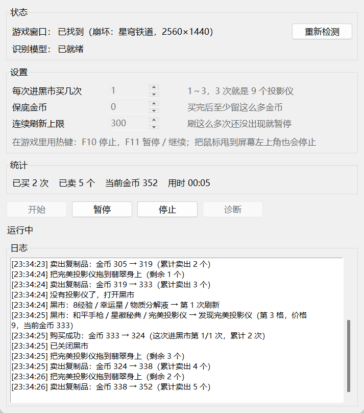

# 货币战争 · 三星翡翠自动刷钱

全自动循环：
1. 点左侧羁绊「黑市主理人」右边的圆形图标，打开翡翠的黑市。
2. 反复点「刷新轮换商品」（免费），出现「完美投影仪」（3 个 9 金币）就买，每次进黑市买 1～3 次。
3. 点左上角空白处关掉黑市。
4. 把道具栏里的完美投影仪拖到棋盘上的翡翠身上，备战席出现复制品。
5. 立刻把复制品拖进左下角的出售区（垃圾桶）卖掉，每个 +14 金币。
6. 投影仪用完后回到第 1 步。

每复制出一个就马上卖掉，备战席同一时间只占一格，不会堆满。

## 下载 exe（推荐）

到 [Releases](https://github.com/FaQxD233/HSR-CurrencyWar-Jade-Coins/releases) 下载 `HSR-CurrencyWar-Jade-Coins.exe`，双击即可，不需要装 Python。

- exe 由 GitHub Actions 用 Nuitka 打包，自带运行环境和识别模型。
- 双击会弹出 UAC 确认框（程序要以管理员身份点击游戏），选「是」。
- 首次启动要解压约十几秒，之后会快很多。
- 配置 `config.json`、日志 `logs/`、诊断截图 `shots/`、异常截图 `debug/` 都放在 exe 所在的文件夹。
- exe 没有数字签名，Windows 可能提示「已保护你的电脑」：点「更多信息」→「仍要运行」。

## 环境

- 游戏分辨率必须是 16:9（如 1920×1080、2560×1440），无边框全屏或窗口化都可以。
- 需要管理员权限：游戏以管理员身份运行，普通权限发出的点击会被 Windows 拦截。
- 从源码运行时需要 Windows + Python 3.11，先安装依赖：

  ```powershell
  python -m pip install -r requirements.txt
  ```

## 使用步骤（图形界面）



1. 双击 exe，或从源码运行时双击 `翡翠刷钱助手.pyw`。源码版的界面会先打开（没有黑色命令行窗口），接着弹出 UAC 确认框申请管理员权限。选「是」后会换成有管理员权限的新窗口。确认框没出现（可能在任务栏闪烁）或点了「否」时，可以点状态区的「获取管理员权限」重试；没有管理员权限时能诊断，但不能开始。
2. 进入货币战争的备战阶段（三星翡翠在场），确认界面上显示「游戏窗口：已找到」「识别模型：已就绪」。没找到窗口就点「重新检测」。
3. 第一次用建议先点「诊断」，5 秒内切回游戏。日志里会显示识别结果，截图存到 `shots/`。
4. 设置每次进黑市买几次（1～3）、保底金币、连续刷新上限，点「开始」，然后切回游戏。设置会自动存进 `config.json`。
5. 运行中可以在界面上点「暂停 / 停止」，也可以在游戏里按 F10 停止、F11 暂停或继续。统计区实时显示已买、已卖、当前金币和用时。

界面窗口不要盖在游戏画面上：程序识别的是游戏画面，被挡住会认错。

界面版的运行记录和启动失败的原因都写在 `logs/gui.log`，出问题时把它发给我。

电脑里装了多个 Python 时，双击可能被交给一个没装依赖的 Python。启动文件会先检查依赖，缺了就自动换用系统里登记的、依赖齐全的 Python 重新打开；一个都找不到时会弹窗写明缺什么、该运行哪条安装命令。

## 介绍视频

`docs/翡翠刷钱助手-介绍.mp4`：约 90 秒，1080p，带字幕和中文语音旁白，用实机截图演示整个流程和界面。视频里的界面画面是用截图模拟游戏时截的，日志里的数字只是示意。

重新生成（需要 ffmpeg 在 PATH 里，旁白用 Windows 自带的中文语音）：

```powershell
python docs/make_video.py
```

## 命令行用法

不想用界面时，也可以用命令行：

1. 先做诊断（不会点击游戏）。进入货币战争的备战阶段，运行：

   ```powershell
   python capture.py
   ```

   切回游戏，在棋盘和黑市界面各按一次 F8，看终端输出：
   - 棋盘：金币、黑市入口坐标、完美投影仪的位置和剩余个数、翡翠的位置、备战席哪些格子有角色。
   - 黑市：三个轮换商品的名字和价格。

   截图会保存到 `shots/`。识别不对就把对应截图发给我。

2. 正式运行。三星翡翠在场（前台或后台都行）的备战阶段，运行下面的命令，然后在 3 秒内切回游戏：

   ```powershell
   python jade_farm.py
   ```

3. 停止：按 F10，或把鼠标甩到屏幕左上角。退出时会打印本次买了几次、卖了几个。

## 安全措施

- 本工具只截图和模拟鼠标操作，不读写游戏内存、不抓包改包。
- 只卖"用投影仪之前是空的、之后出现了角色"的备战席格子，而且要认得出是翡翠；不是翡翠就暂停，不卖。
- 棋盘上的三星翡翠本体和其他角色不会被拖动。
- 每次点击或拖动后都会重新截图，确认画面发生了预期的变化。没反应就重试一次，还不行就暂停。

## 什么时候会自动暂停（响铃）

| 情况 | 你要做的 |
|---|---|
| 买完剩下的金币会低于 `gold_reserve` | 攒够金币后按 F11 继续 |
| 连续刷新 `max_refreshes` 次都没出现目标 | 看看黑市是否正常，按 F11 继续 |
| 棋盘上没找到翡翠，或备战席满了 | 调整阵容 / 腾出备战席后按 F11 继续 |
| 新出现的角色不像翡翠 | 自己看一眼备战席，处理后按 F11 继续 |
| 刷新没反应、购买没确认成功、黑市打不开或关不掉、复制品没出现、复制品没卖掉、认不出当前画面 | 当时的画面会存进 `debug/`，把图片和终端输出发给我 |
| 游戏切到后台 | 不响铃，自动等待；切回游戏 1 秒后继续 |

## 配置（config.json）

| 项 | 默认值 | 说明 |
|---|---|---|
| `window_titles` | `["崩坏：星穹铁道", "Honkai: Star Rail"]` | 游戏窗口标题 |
| `target` | `"完美投影仪"` | 要买的轮换商品，识别时允许错 1 个字，但「员工投影仪」不会被当成目标 |
| `buys_per_visit` | `1` | 每次进黑市买几次，1～3（3 次就是 9 个投影仪） |
| `gold_reserve` | `0` | 买完后至少保留多少金币 |
| `max_refreshes` | `300` | 连续刷新多少次没出现目标就暂停 |
| `stop_key` / `pause_key` | `"f10"` / `"f11"` | 停止键 / 暂停继续键 |

## 文件

| 文件 | 作用 |
|---|---|
| `翡翠刷钱助手.pyw` | 源码版：双击启动图形界面（被没装依赖的 Python 打开时会自动换用合适的 Python） |
| `app.py` | 打包入口：Nuitka 把它编译成 exe；`--self-check` 参数供打包流水线自检 |
| `.github/workflows/build.yml` | GitHub Actions：推送 `v*` 标签时用 Nuitka 打包 exe、自检并发布 Release |
| `requirements.txt` | 源码运行和打包所需的依赖（版本已固定） |
| `gui.py` | 图形界面：设置、开始 / 暂停 / 停止、诊断、统计和日志 |
| `jade_farm.py` | 主程序：状态机、配置读写、热键，以及命令行入口 |
| `vision.py` | 识别：OCR、模板匹配、各界面元素的 1920×1080 设计坐标 |
| `winio.py` | Windows 平台层：DPI、管理员权限、窗口、截图、点击、拖动 |
| `capture.py` | 诊断：按 F8 截图并打印识别结果（界面里的「诊断」按钮复用它） |
| `assets/` | 识别模板（道具栏的完美投影仪图标、翡翠卡面的脸部）和程序图标 |
| `docs/` | 介绍视频、视频生成脚本 `make_video.py`、界面截图 `gui.png` |
| `tests/` | 用 `shots/` 里的实机截图测试识别、状态机和界面（`fakes.py` 是按截图切换画面的假游戏）。实机截图带 UID，不放进仓库；缺截图时这些测试会自动跳过 |

## 测试

```powershell
python -m pytest
```

真实鼠标测试默认跳过（会移动鼠标并点击一个临时窗口）。要运行它，在 PowerShell 里执行：

```powershell
$env:JADE_LIVE_INPUT='1'; python -m pytest tests/test_input_live.py
```

## 致谢

界面坐标参考了 [March7thAssistant](https://github.com/moesnow/March7thAssistant) 的货币战争 S2 识别代码（GPL-3.0），本项目未复制其代码。
